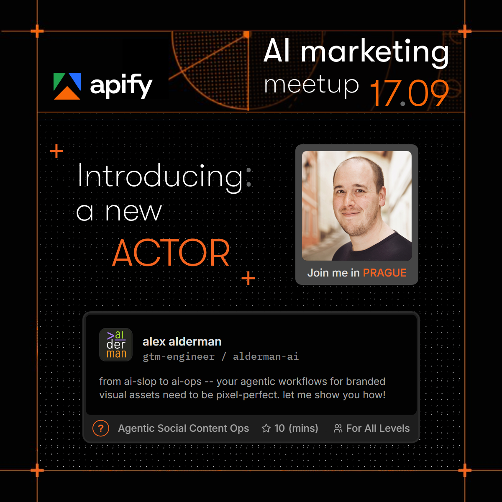

# Automated visual content, with pixel-perfect branded elements

An AI agent makes the image. The brand parts land on the same pixel every time.

**Built by [Alex Alderman](https://alderman.agency) for his talk at the AI Marketing Meetup hosted by [Apify](https://apify.com) on 17 Sep 2026, where it ran live in front of roughly 200 marketers.**

> [!NOTE]
> **Brand disclaimer.** This is an unofficial, non-commercial demo. Apify's name, logo and visual design belong to Apify. The card is a reproduction of apify.com's public actor-card design, rebuilt from scratch as an homage for a community-event teaser. It is not affiliated with Apify, and nothing here implies that Apify supports or endorses it, or that it endorses Apify. No social or custom-coded web assets were **seriously harmed** in the process of making this demo, **just a minor scrape** 🥰

<p align="center">
  
</p>
<p align="center"><sub>One finished card. The agent supplied the words and the photo. Code drew everything else.</sub></p>

Ask an image model for a branded visual and you get a new invention every time: shifted spacing, misspelled words, a logo that drifts a little further from the real one on each run. So someone senior checks every logo before anything reaches a client.

This demo splits the job. The brand is code, written once: layout, fonts, frame, logo slot. The agent only supplies the words and pictures, and every word is counted against a hard limit before it touches the layout. The 23 example cards in this repo share one identical layout; the fiftieth would too.

It's for small agencies whose teams already use AI every day and whose clients' brand rules can't bend.

## See it on your own laptop in about ten minutes

Paste this into Claude Code, Cursor, Codex or any agent that can open a folder:

```text
Clone https://github.com/alderman-ai/pixel-perfect-branded-assets-demo and open the folder.
Read its AGENTS.md, then show me the demo.
```

Already have the folder open in your agent? Point it at `AGENTS.md` and say:

```text
Tell me more about this demo
```

1. Your agent answers with a three-line menu.
2. Option 1 leads you through the process of replicating the demo. But...
3. I think learning the principles behind why it's useful (option 2) and how it was built (option 3) are more interesting.
4. And probably more interesting than that was how the demo was presented live. It's a bit buried, but ask your llm:

```text
Can you tell me more about how the demo was presented live and what was interesting about that?
```

**Is it safe to run?** The repo holds zero scripts and installs nothing. The one program it uses is the Chrome or Edge already on your machine, opened invisibly to photograph the card from files inside the folder, and nothing is downloaded at any point. Your agent also puts your work on a git branch of its own, so the files you cloned stay as they were. Every piece of code is listed in [scripts-and-security.md](demo-and-more-help/about-this-project/scripts-and-security.md).

### Rather just read? The idea in five lines

- A language model gives a slightly different answer every time. A brand asset needs the same result every time.
- So code the parts that must be exact (layout, fonts, frame, logo position) once, and they never vary again.
- Let the AI write the parts that should vary (name, role, blurb), each held to a hard character limit.
- Over a limit, the run stops and says what to fix. It never shrinks your text or stretches the card.
- Any brand that already has web components has the coded half sitting in its codebase today.

The longer explanation is [seven one-screen pages](demo-and-more-help/probabilistic-vs-deterministic/INDEX.md), and the [gallery](demo-and-more-help/probabilistic-vs-deterministic/gallery.md) shows 23 more cards from the same code.

## Why the card says "AI marketing meetup 17.09"

I built this for my live demo at the AI marketing meetup Apify hosted on 17 Sep 2026. The card is a speaker teaser for that event, so the event header, the Apify logo and "Join me in PRAGUE" are part of the fixed design. Your card keeps them. Only your words and pictures change. (The brand disclaimer at the top of this page applies to every card.)

## Who made this

I'm [Alex Alderman](https://alderman.ai). I worked in Czech marketing agencies, then ran my own boutique B2B tech marketing agency, then pivoted fully to AI implementation for marketing teams. For three years I cut my client load roughly in half to study and build things like this.

You get pitched AI services daily. I'd rather show you something that works on your own laptop. The same split (code for the brand, AI for the words, hard limits in between) carries over to your clients' brands: their components, their fonts, their layouts. For your developer, [forking-for-your-own-brand.md](demo-and-more-help/how-this-was-built/forking-for-your-own-brand.md) lists exactly what gets swapped and what stays.

If it sparks something, take 30 minutes with me: **https://calendar.app.google/biAvGYqEqUtmtsNv9**. Either you take what I show you and experiment with it on your own, or we schedule a follow-up to consider working together. Either outcome works for me.

CZ marketing is a small world, and I'm not going to burn my credibility by wasting your time. -Alex

---

## The long version

Everything below is reference for the curious. Your agent reads `AGENTS.md` (Claude Code reaches it through a one-line `CLAUDE.md`) and doesn't need any of it.

### The short version, in my own words

- `_IN_` A few speaker details + IMG files into a fully agentic pipeline
- `_OUT_` one pixel-perfect, Apify branded LinkedIn image
- `_OR_` 30 images? 50? Just like at the arcade, you can play until you're out of tokens.
- `_WITH_` no brand kit, no Apify design assets 😇 ... asked for.

### It runs on any laptop with Chrome or Edge

You need two things:

- **An AI agent that can work in a folder**: Claude Code, Cursor, Codex or similar. It has to be able to open this folder, read and write files in it, and run one command.
- **Google Chrome, or the Microsoft Edge that comes with Windows.** The agent runs it invisibly ("headless", meaning no window opens) to draw the image. You never open it yourself.

Fonts, card code, template and instructions all ship inside this folder. There are no packages to install and nothing is fetched from the internet.

### What the finished image is made of

Two elements sit on a fixed 1200×1200 backdrop (dark, orange-framed, with a starfield that brightens toward the bottom, all baked into the template):

- **The actor card**: Apify's `ActorStoreItem` component rebuilt in plain HTML/CSS and checked box for box against the live site to 0.001px. Your name, role / company, blurb, topic and talk length fill its slots (the audience level is fixed at "For All Levels"). It uses the real Inter and IBM Plex Mono fonts, real ellipsis behaviour and the real hover ring.
- **The speaker element**: a matching grey-framed card holding your photo, made square, with **Join me in PRAGUE** underneath. Its frame, corners and copy are fixed. Only the photo is yours.

### The details it asks for

You never have to open the form yourself. The agent writes in what you tell it and checks each limit as it goes. (Filling the form by hand works too; each labelled box says what goes where.)

| field | where it lands | limit |
|---|---|---|
| company logo | 40×40, top left of the card | square PNG/ICO/JPG/JPEG, at least 80×80, with its own background (it sits on a light plate) |
| speaker name | card title | 30 characters |
| position / company | monospace line, joined as `position / company` | 39 characters including the ` / ` |
| description | card body, two lines at most | 115 characters |
| topic category | card footer, left | 26 characters |
| level | card footer, after 👥 | fixed: `For All Levels`, not an input |
| duration | card footer, after ★ | number only; the card shows `10 (mins)` |
| speaker photo | square photo slot of the speaker element | PNG/JPG/JPEG, any size, roughly square (sides within 25% of each other) |

The photo is trimmed evenly on its longer side to an exact square and resized into place. A photo further from square than that stops the run with its measured size and one fix: crop it roughly square and resend. The annotated picture is `demo-and-more-help/filling-in-the-form/Actor card field mapping.png` and the limits table is `demo-and-more-help/filling-in-the-form/Actor card text budgets.png`.

### Wrong input stops the run instead of bending the brand

A blurb that's too long, a missing image, a photo far from square: each one stops the run and says exactly what to fix. The agent never trims your text on its own, never guesses how to reframe your photo, never stretches the card and never overwrites a file.

Each card moves through three folders:

```
to-process/<speaker>/                 the agent builds this from what you tell it:
                                      intake.md, README.md, company-logo.png, speaker.png
processed/<speaker>/                  the folder moves here on success (archive)
generated-images/<speaker>-final.png  the finished image, ready to post
```

A folder lives in exactly one place. Failures stay put with a printed reason and write nothing partial. A name that's already taken gets a `-01`, `-02`… suffix (the author's own card already holds `alex-alderman`, so a second Alex lands as `alex-alderman-01`).

**A missing image** stops the run with a choice: resubmit, or render now with a dashed placeholder outline that the right image covers completely later.

### Two core files, changed only on purpose

Every card is generated from one backdrop image, `_internal/core-templates-please-dont-touch/speaker-teaser-linkedin_v4.png` (1200×1200, final for this demo), and one blank form, `intake-template.md` beside it (v5). The two coloured blocks on the backdrop show where the card and the photo land; their positions were measured once and are fixed numbers in the form, so a run never re-measures anything and never asks you about it. Changing either file is a deliberate, versioned step, described in that folder's README.

One check runs every time: the card's block on the backdrop must match the card as it actually renders (within 2px at the card's own scale, about 4px on the finished image). The card's height steps with its number of blurb lines, so it can't be stretched to fit a wrong block. The run stops and says what height the block should be.

### The agent's instructions are two markdown files you can read

| skill | file | what it does |
|---|---|---|
| `new-speaker` | `_internal/skills/new-speaker.md` | sets up one speaker folder in `to-process/`, then either lets you fill the form yourself or collects the details from you in chat and writes them in |
| `apify-speaker-card` | `_internal/skills/apify-speaker-card.md` | the whole generator: checks the form, loads the fixed positions, renders, inspects and delivers. It also holds the "Line 1" flow the menu's first line runs |

Any agent runs one just by reading it. `AGENTS.md` routes requests to them.

### Where things are

```
README.md                     this page
AGENTS.md                     what your agent reads first
CLAUDE.md                     one line, @AGENTS.md, so Claude Code loads the same file
generated-images/             the finished PNGs (<speaker>-final.png)
to-process/  processed/       the queue, built and moved by the agent
demo-and-more-help/           the help folder: filling in the form, 23 example
                              cards, the safety inventory, the idea behind the
                              project (menu line 2) and how it was built
                              (menu line 3). Start at its README.md
_internal/                    machinery you never edit: the two instruction
                              files, the worked example, the render page,
                              the fonts and the two core files
```

Every folder carries its own `INDEX.md` describing what's inside.

### Fonts and licences

Bundled: **Inter** and **IBM Plex Mono**, the two faces apify.com serves for the card, under the SIL Open Font License 1.1 (`_internal/fonts/licenses/`). Both are free to redistribute and are stored locally, so a render never depends on a font server. GT Walsheim, apify.com's heading face, is a commercial font and is deliberately left out of this repo.
